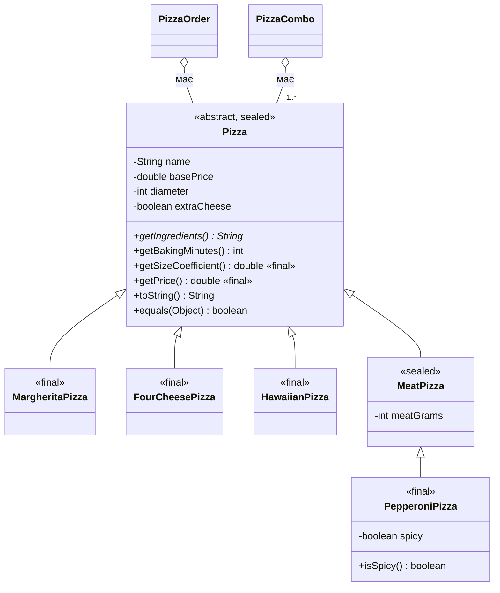

# ЛР6. Ієрархія класів на основі наслідування (піцерія)

Це **рефакторинг** коду ЛР1–5, а не новий проєкт. Проблемне місце, знайдене в
проєкті: вид піци був лише рядком `pizzaName` + числом `unitPrice`, а тип
визначався ланцюжком `if / else if` за номером меню в `Main` (так само розмір
→ коефіцієнт ціни). Тепер кожен вид піци — окремий клас ієрархії `Pizza`.

## Діаграма класів



## Рівень 1. Базовий

**Перевірка «is-a»:** «Маргарита є різновидом піци» ✔, «Пепероні є різновидом
м'ясної піци» ✔. Навпаки («піца має маргариту») — безглуздо.

* `Pizza` містить спільні поля (`name`, `basePrice`, `diameter`, `extraCheese`),
  конструктор, валідацію діаметра, розрахунок ціни. Усі поля — `private`,
  підкласи користуються гетерами (`protected` не знадобився).
* У підкласах — лише специфічне: `meatGrams` (`MeatPizza`), `spicy` (`PepperoniPizza`).
* Конструктори підкласів викликають `super(...)`.
* `@Override`: `getIngredients()` у кожному підкласі, `getBakingMinutes()`, `toString()`.
  `MeatPizza.toString()` і `PepperoniPizza.toString()` будують рядок із `super.toString()`.
* Поліморфізм: `InheritanceDemo.demoPolymorphism()` — `List<Pizza>` з різними
  підкласами, у циклі викликаються перевизначені методи. Також `PizzaFactory.menu()`
  будує меню в `Main` поліморфно.

## Рівень 2. Середній

* **Абстрактний клас.** `Pizza` абстрактна: «просто піца» без назви й складу в
  піцерії не існує. Абстрактний метод `getIngredients()`: склад унікальний для
  кожного виду, змістовної реалізації за замовчуванням немає; звичайний метод
  повернув би вигадане значення, і підклас міг би забути його перевизначити,
  а абстрактний змушує компілятор це вимагати.
* **Три рівні:** `Pizza → MeatPizza → PepperoniPizza`. Ланцюжок конструкторів
  (виводиться в `InheritanceDemo`, коли `Pizza.setTraceConstructors(true)`):
  ```
  [Pizza] конструктор базового класу: Пепероні
  [MeatPizza] конструктор другого рівня, м'яса: 100 г
  [PepperoniPizza] конструктор третього рівня, гостра: false
  ```
  Порядок: конструктор підкласу першим ділом викликає `super(...)`, тому спершу
  повністю виконується конструктор предка (ініціалізуються його поля), і лише
  потім — тіло конструктора нащадка.
* **`this(...)`:** `Pizza(name, price)` → `Pizza(name, price, diameter)` →
  головний конструктор; у підкласах `new MargheritaPizza()` делегує до
  `MargheritaPizza(int, boolean)`. Уся ініціалізація — в одному місці.
* **`final`:** методи `getSizeCoefficient()` і `getPrice()` — `final`, бо
  коефіцієнт за діаметр (25 см −20 %, 35 см +25 %, 40 см +50 %) — бізнес-правило
  піцерії, підклас не повинен його змінювати, інакше чеки за однаковий розмір
  різнилися б. Листові класи також `final`.
* **`instanceof` з pattern matching:** `if (p instanceof PepperoniPizza pepperoni)
  { pepperoni.isSpicy(); }`.
  **Статичний тип** — тип у декларації змінної (`Pizza p`), за ним компілятор
  вирішує, які методи можна викликати (`p.isSpicy()` не скомпілюється).
  **Динамічний тип** — фактичний клас об'єкта (`PepperoniPizza`), за ним під час
  виконання вибирається версія перевизначеного методу.

## Рівень 3. Високий

* **`equals()`/`hashCode()`:** перевизначені в `Pizza`, `MeatPizza` (нове поле
  `meatGrams`) і `PepperoniPizza` (нове поле `spicy`). Обрано перевірку через
  **`getClass()`**: об'єкти рівні, лише якщо мають точно той самий клас.
  Результат у демо: `meat.equals(pepperoni) == false` і `pepperoni.equals(meat)
  == false` — симетрія збережена. З `instanceof` (клас `BadBase/BadSub` у
  `InheritanceDemo`) вийшло `base.equals(sub) == true`, але
  `sub.equals(base) == false` — симетрію порушено. Спроба «виправити» це
  порівнянням без нових полів порушила б транзитивність. Мінус `getClass()` —
  підклас не підставляється замість предка в `equals` (формально обмежує принцип
  Лісков), але для класів, що додають стан, це безпечніше. Оскільки всі класи
  ієрархії `final`/`sealed`, анонімних підкласів, які зламали б порівняння, немає.
* **Композиція замість наслідування:** `PizzaCombo` (кілька піц + напій).
  Спокуса — `PizzaCombo extends Pizza`, але «комбо є піцею» — хибно: комбо
  *має* піци. При наслідуванні зламалось би: у комбо немає єдиного `diameter` і
  `getIngredients()`; успадковані `getSizeCoefficient()`/`getPrice()` (`final`)
  рахують ціну однієї піци й дають хибний результат; комбо довелося б
  дописувати у `permits` і в кожен `switch` по `Pizza`; будь-який код, що очікує
  `Pizza`, вважав би, що це одна піца. Тому `PizzaCombo` тримає `List<Pizza>`.
  Так само `PizzaOrder` *має* `Pizza` (поле), а не успадковує її.
* **Діаграма** — вище.
* **Sealed (самостійно):** `Pizza` — `sealed ... permits MargheritaPizza,
  FourCheesePizza, HawaiianPizza, MeatPizza`; `MeatPizza` — `sealed ... permits
  PepperoniPizza`; решта — `final`. У `InheritanceDemo.category(Pizza)`
  ланцюжок `if (x instanceof ...)` замінено на `switch` із pattern matching без
  `default`. **Гарантія для компілятора:** множина підтипів закрита й відома, тому
  `switch` перевіряється на вичерпність: додаєш новий вид піци в `permits` —
  усі `switch` без `default` перестають компілюватися, доки не обробиш новий
  випадок. Порядок `case` має значення: `PepperoniPizza` перед `MeatPizza`
  (інакше помилка dominance).

## Що змінено порівняно з ЛР5

| Файл | Зміна |
| --- | --- |
| `Pizza`, `MargheritaPizza`, `FourCheesePizza`, `HawaiianPizza`, `MeatPizza`, `PepperoniPizza` | **нові** — ієрархія |
| `PizzaFactory`, `InvalidMenuItemException` | **нові** — замінюють `if/else` за номером меню |
| `PizzaCombo`, `InheritanceDemo` | **нові** — композиція та демонстрації |
| `PizzaOrder` | замість `String pizzaName` + `double unitPrice` тримає `Pizza` |
| `Main` | меню, вибір піци, розмір, ціна — через `PizzaFactory`/`Pizza`; виклик `InheritanceDemo.run()` |
| решта (винятки, Strategy, Observer, платежі, Adapter) | без змін |

Поведінка програми збережена: ті самі ціни й чеки (напр., пепероні 35 см ×3 з
сиром і знижкою за кількістю = 718.88 грн). Єдина відмінність: невірний номер
меню тепер кидає `InvalidMenuItemException` (повідомлення те саме), тому
демонстраційні блоки після `try` теж виконуються.

## Компіляція та запуск

Потрібна JDK 25 (використовується `IO.println` та unnamed-клас `Main`).

```bash
javac *.java
java Main
```

## Git-flow

```bash
git checkout -b lr6/pizza-inheritance
git add *.java README.md
git commit -m "LR6: pizza class hierarchy (inheritance, abstract, sealed, composition)"
git push -u origin lr6/pizza-inheritance
# після цього створити Pull Request у main
```
